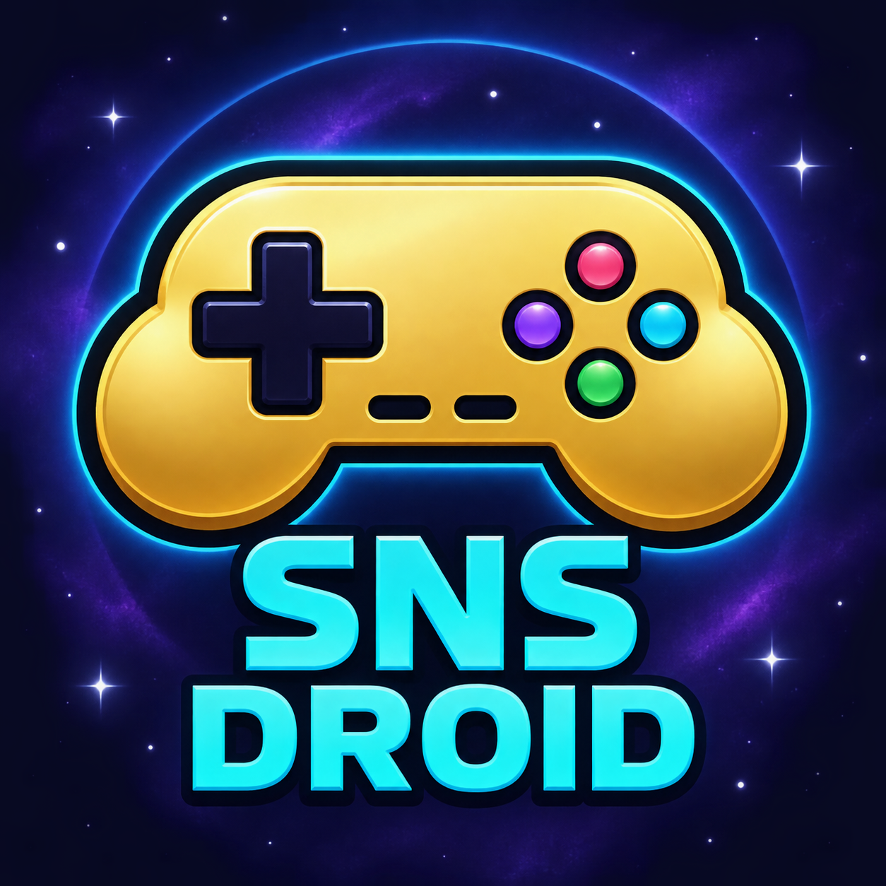
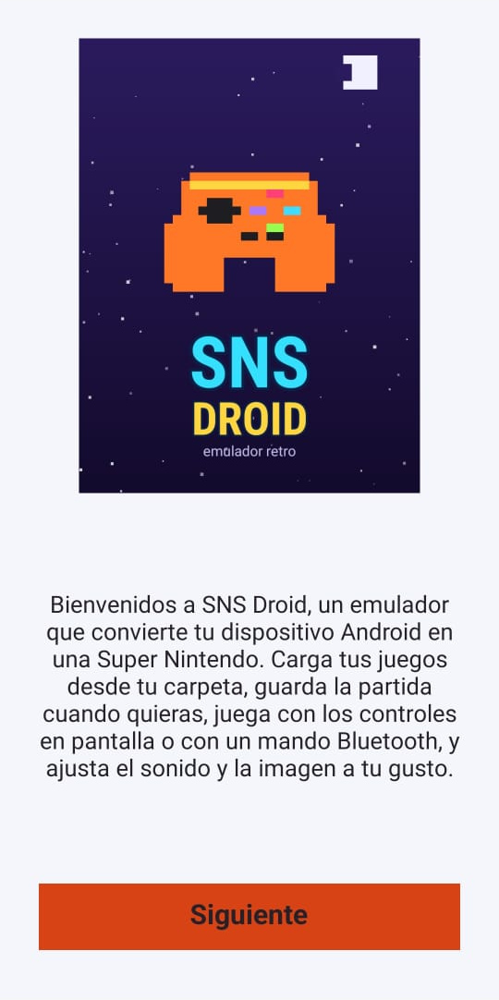
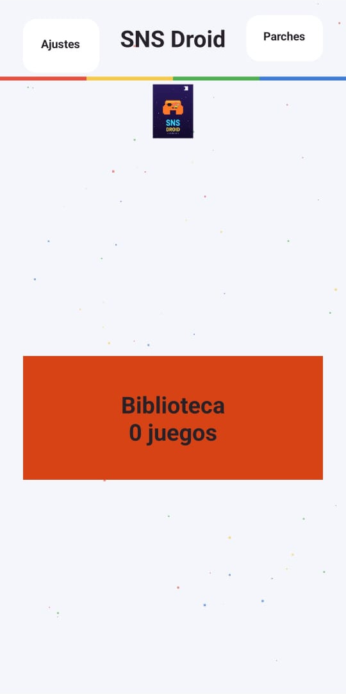
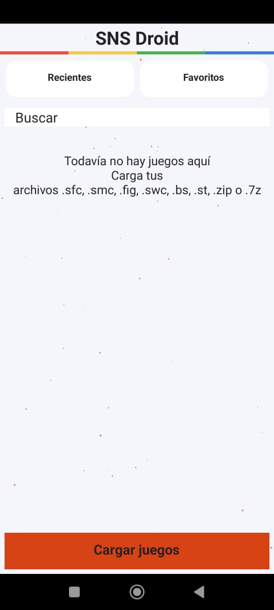
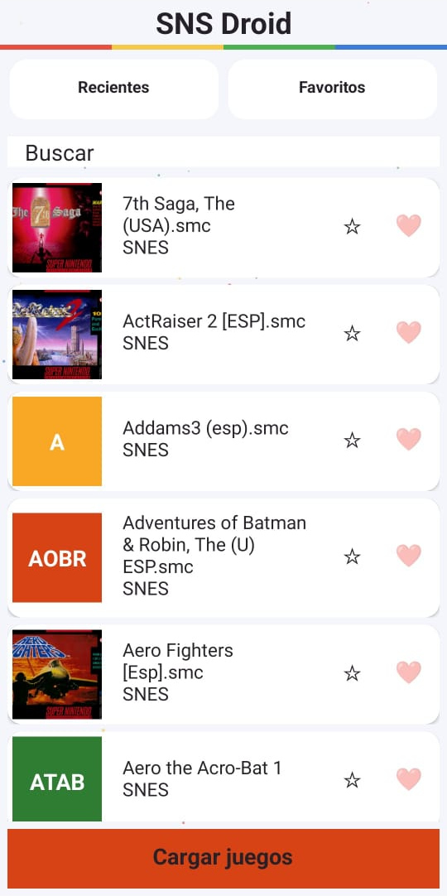
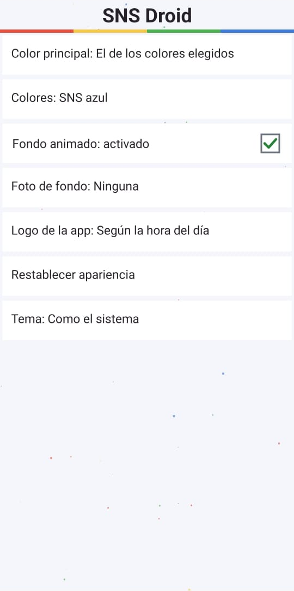

  

Imagen de presentación del proyecto. Es distinta del icono fijo de Android y de los 18 diseños de logo que se muestran dentro de la app.

# SNS Droid

SNS Droid es un emulador de Super Nintendo para Android. Nació como un primer proyecto, a partir de la idea de crear un emulador propio.

¿Qué es SNS Droid?

Es una app para jugar juegos de Super Nintendo en tu celular Android.

Cómo empezó: el proyecto comenzó con la idea de tener un emulador propio, con su nombre y sus decisiones de diseño y funcionamiento. Se fue armando paso a paso, desde las versiones de prueba y las correcciones de fallos hasta las versiones Alpha y esta Beta.

Qué se fue agregando: biblioteca con buscador, controles táctiles que se pueden mover, soporte para mandos con botones configurables, guardados rápidos y autoguardado, música y sonidos personalizables, y la sección de Parches para aplicar hacks y traducciones sin tocar el juego original. También se agregaron "Me gusta" y "Favoritos", al estilo de TikTok, para darle un toque moderno a un emulador retro.

Compatibilidad: se trabajó para que funcione en Android 6 hasta Android 16, con juegos en ZIP y 7z, ROM hacks y juegos parcheados. Admite juegos de SNES de Japón, Estados Unidos y Europa, con detección automática de NTSC/PAL según la cabecera de la ROM, sin garantizar compatibilidad con todo el catálogo. También se fue ajustando para que corra mejor en teléfonos de pocos recursos.

Esta Beta 3 ya está disponible para probarla.

Qué trae
- Biblioteca con buscador, Recientes, Favoritos y Me gusta.
- Escanear juegos: eliges una carpeta y tus juegos se añaden a la Biblioteca.
- Carátulas que se descargan solas cuando hay internet.
- Controles táctiles ajustables y asignación de botones del mando.
- Cuatro ranuras de guardado, autoguardado, avance rápido y rebobinado según la memoria disponible.
- Idioma: Español, Español de España, English y Português de Brasil.
- Apertura de juegos sueltos o en ZIP y 7z, dentro de los formatos admitidos.
- Parcheado integrado para juegos de SNES: aplica archivos IPS, BPS o UPS descargados por separado, sin otras apps ni páginas web de parcheado para los formatos admitidos. Guarda una copia nueva, sin modificar el original, suelta o en ZIP/7z.
- Reportes de fallos y medición de rendimiento.

- Logo dentro de la app con 18 diseños: seis de día, seis de tarde y seis de noche. En Ajustes > Apariencia > Logo de la app puedes elegir Según la hora del día, Cambiar cada vez que abro la app o Fijo, yo lo elijo.
- Icono fijo en la pantalla de inicio de Android: un mando dorado con las letras SNS sobre fondo morado con estrellas. Es distinto de los logos de dentro de la app y de la imagen de presentación de GitHub.
- Música por pantalla, con temas de la app o archivos que tú elijas. Se activa en Ajustes > Sonidos > Música.
- Efectos de sonido que se pueden silenciar juntos en Ajustes > Sonidos, sin apagar el audio del juego.
- Detección automática de mandos compatibles, con aviso en pantalla.
- 13 efectos de imagen, 12 máscaras y ajustes de tamaño, posición, rotación y colores.
- Trucos, retroceso, cámara lenta y autoguardado periódico configurables.

En algunos dispositivos podría no abrirse Apariencia. El problema sigue en investigación; puede reportarse desde Ajustes > General > Reportar fallos.

## Parches para Super Nintendo

SNS Droid incluye su propio sistema de parcheado para juegos de Super Nintendo. Para aplicar parches IPS, BPS o UPS compatibles no hace falta usar otras apps como UniPatcher o ROM Patcher, ni páginas web de parcheado (hay varias, como Rom Patcher JS): el parche se descarga por separado y se aplica dentro del emulador.

Permite aplicar traducciones y modificaciones con parches IPS, BPS o UPS. Se guarda una copia nueva; la ROM original y el archivo del parche no se modifican. El parche debe corresponder a la versión, región y cabecera exactas de la ROM base que indique su autor.

### Cómo se aplica un parche

1. Desde la pantalla de inicio se abre Parches.
2. En "1. Elegir ROM original (suelta o en ZIP/7z)" se selecciona el juego base. Si está comprimido, el ZIP o 7z debe contener un solo juego; si hay varios, la app no elige uno automáticamente.
3. En "2. Elegir parche IPS, BPS o UPS" se selecciona el archivo del parche ya descargado y sin comprimir.
4. En "3. Formato del juego resultante" se puede dejar activado "Automático: conservar contenido y formato". Conserva exactamente el resultado del parche, sin convertir cabeceras ni reorganizar datos. Conserva la extensión de los formatos antiguos; para los demás propone .sfc. Al desactivar Automático aparece "Formato de salida" para elegir una conversión admitida.
5. En "4. Cómo guardar la copia" se elige Sin comprimir, ZIP o 7z. Si se usa compresión, aparece "5. Nivel de compresión", con Rápida, Normal o Máxima.
6. Se pulsa "Aplicar y guardar". Para IPS aparece antes un aviso: ese formato no comprueba que la ROM base sea la correcta. Después se abre el selector de Android para elegir el nombre y el destino de la copia.
7. Cuando termina, aparece "Parche aplicado con éxito." y se puede usar "Ver el parche guardado". La copia se registra como juego parcheado. Para añadirla a la Biblioteca se puede escanear la carpeta donde se guardó.

Los juegos ya parcheados fuera de la app pueden marcarse desde Ajustes > Registrar juego parcheado existente. Las copias creadas con Parches quedan marcadas automáticamente. En la Biblioteca se puede cambiar el nombre de los juegos marcados y, cuando corresponde, el de su archivo.

Requiere Android 6.0 o posterior.

Es una Beta: todavía puede tener fallos. No se garantiza compatibilidad con todos los juegos o mandos. ST011 y ST018 tienen soporte parcial; Super Game Boy no está implementado.

Para reportar un problema, se puede abrir un issue en este repositorio e indicar el teléfono, la versión de Android, el juego que se abrió y qué ocurrió.

## Cómo instalar

1. Entra a la sección Releases y descarga el archivo APK más reciente.
2. Ábrelo en tu teléfono. Si Android te lo pide, permite instalar apps desde esta fuente.
3. Abre SNS Droid y elige la carpeta donde tienes tus juegos.

## Capturas

  
  
  

  
  

  
  

