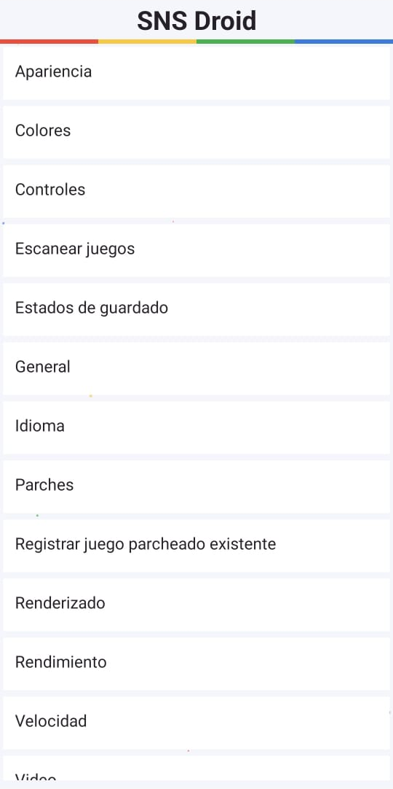
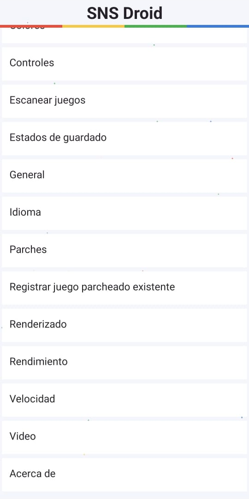

# SNS Droid

Les presento SNS Droid, un emulador de Super Nintendo para Android. Nació de una idea mía y es mi primer proyecto.

¿Qué es SNS Droid?

Es una app para jugar juegos de Super Nintendo en tu celular Android.

Cómo empezó: todo comenzó con mi idea de tener un emulador propio. Le puse el nombre, decidí cómo debía verse y funcionar, y lo fui armando paso a paso. Empecé con versiones de prueba y fui corrigiendo lo que fallaba. Luego pasé a las versiones Alpha y ahora llegué a esta Beta.

Qué fui agregando: biblioteca con buscador, controles táctiles que se pueden mover, soporte para mandos con botones configurables, guardados rápidos y autoguardado, música y sonidos personalizables, y la sección de Parches para aplicar hacks y traducciones sin tocar el juego original. También fue idea mía agregar "Me gusta" y "Favoritos", al estilo de TikTok, para darle un toque moderno a un emulador retro.

Compatibilidad: trabajé para que funcione en Android 6 hasta Android 16, con juegos de las regiones Japón, Estados Unidos y Europa, en ZIP y 7z, y con ROM hacks y juegos parcheados. También lo fui ajustando para que corra mejor en teléfonos de pocos recursos.

Con esta Beta 2 ya lo comparto para que lo prueben.

Qué trae
- Biblioteca con buscador, Recientes, Favoritos y Me gusta.
- Escanear juegos: eliges una carpeta y tus juegos se añaden a la Biblioteca.
- Carátulas que se descargan solas cuando hay internet.
- Controles táctiles ajustables y asignación de botones del mando.
- Diagnóstico de botones del mando, en Ajustes > Controles.
- Cuatro ranuras de guardado, autoguardado, avance rápido y rebobinado según la memoria disponible.
- Ajustes de imagen, sonido, orientación y apariencia.
- Idioma: Español, Español de España, English y Português de Brasil.
- Música por pantalla, opción de elegir tus propios archivos de música y sonidos distintos para toque y mando.
- Apertura de juegos sueltos o en ZIP y 7z, dentro de los formatos admitidos.
- Parches IPS, BPS y UPS para guardar una copia modificada sin cambiar el original.
- Reportes de fallos y medición de rendimiento.

Parches
Con SNS Droid ya no necesitas aplicaciones aparte como Delta Patcher para parchear tus juegos de Super Nintendo: el emulador tiene su propio sistema de parcheado y guarda una copia sin cambiar el original.

Si ya tienes juegos parcheados, puedes marcarlos en Ajustes > Registrar juego parcheado existente: eliges un juego de tu Biblioteca, confirmas que ya está parcheado y queda marcado. Las copias que creas con Parches quedan marcadas solas como parcheadas. En la Biblioteca, a un juego marcado le puedes poner un nombre y cambiar el nombre de su archivo.

Cómo se parchea
1. En la pantalla de inicio entra en Parches.
2. Elige la ROM original, suelta o dentro de un ZIP o 7z.
3. Elige el parche.
4. Elige el formato del juego resultante. Puedes dejarlo en Automático.
5. Elige cómo guardar la copia: sin comprimir, ZIP o 7z.
6. Pulsa Aplicar y guardar y elige dónde guardarla.

Formatos de parche: IPS, BPS y UPS.

Formatos del juego base: .sfc, .smc, .fig, .swc, .bin, .rom, .bs, .st, .gd3, .gd7, .dx2, .ufo, .mgd y .mgh, sueltos o dentro de ZIP o 7z.

Formatos del juego resultante: son nueve opciones: .sfc, .smc, .swc, .fig, .dx2, .ufo, .gd3, .gd7 y MGD/MGH (conjunto de archivos). También está Automático, que conserva el resultado del parche tal cual.

Usa la versión exacta del juego que pide el parche.

Requiere Android 6.0 o posterior.

Es una Beta: todavía puede tener fallos. No prometo compatibilidad con todos los juegos o mandos. ST011 y ST018 tienen soporte parcial; Super Game Boy no está implementado.

Si encuentras un problema, cuéntame qué teléfono y versión de Android usas, qué juego abriste y qué pasó, o abre un issue en este repositorio. No adjuntes juegos, BIOS ni información privada.

## Cómo instalar

1. Entra a la sección Releases y descarga el archivo APK más reciente.
2. Ábrelo en tu teléfono. Si Android te lo pide, permite instalar apps desde esta fuente.
3. Abre SNS Droid y elige la carpeta donde tienes tus juegos.

## Capturas

  
  
  

  
  
  

